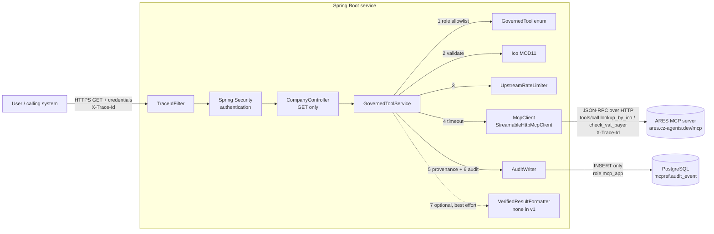
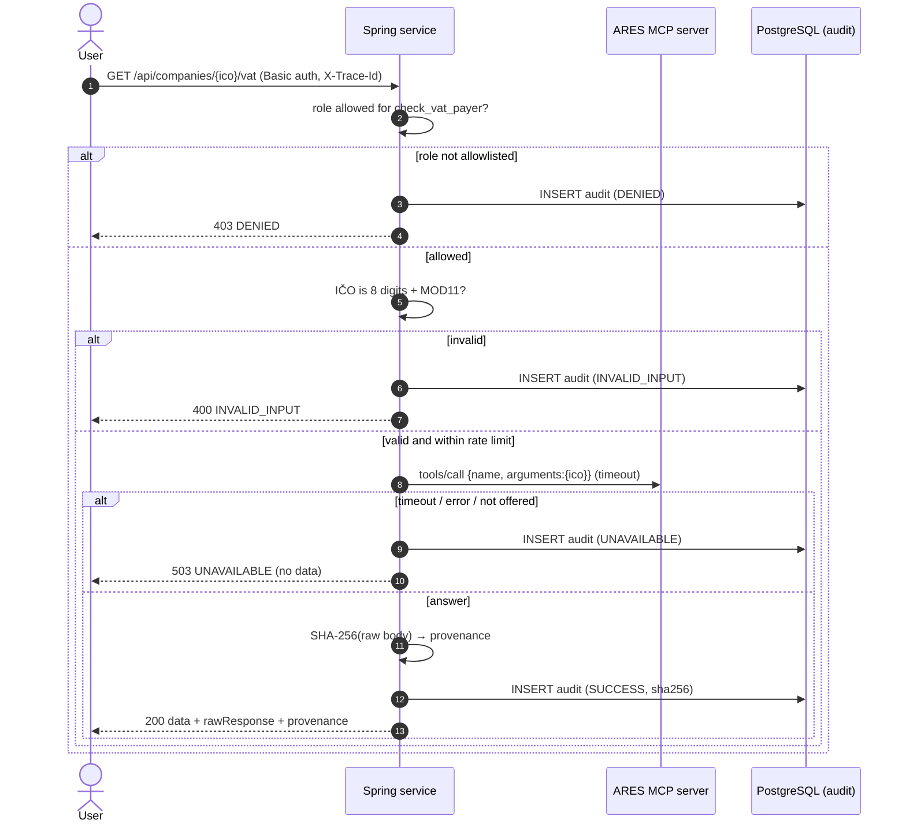

# MCP as a governed integration adapter in a Spring application

A small **reference implementation**, built to show an architecture rather than to be a product. A Spring Boot service acts as an **MCP client** to the public ARES MCP server (`https://ares.cz-agents.dev/mcp`). It exposes two read-only lookups by Czech company ID (IČO), and every call goes through code-enforced controls:

- role-bound tool access, enforced in Java;
- a single validated parameter (IČO with a MOD11 checksum);
- provenance on every result;
- an append-only audit trail in PostgreSQL that is enforced by database grants;
- explicit `UNAVAILABLE` instead of a guessed answer;
- a trace id carried end to end.

There is **no LLM** in v1. The design has one optional extension point where an LLM could format an already-verified result, and nothing depends on it.

> **Shrnutí (CZ):** Referenční implementace ukazuje MCP jako řízený integrační adaptér ve Spring aplikaci. Uživatel se přihlásí (Spring Security). Podle role smí volat jen povolené nástroje ARES: vyhledání subjektu podle IČO, nebo ověření plátce DPH. Oprávnění jsou vynucena v Javě, nikoli v promptu. Na vstupu je jediný parametr, IČO ověřené kontrolním součtem MOD11. Každý výsledek nese provenienci (zdroj, nástroj, čas, SHA-256 surové odpovědi, verze adaptéru). Každé volání se zapíše do auditní tabulky v PostgreSQL, do které aplikační DB role smí pouze vkládat. Když upstream nedostupný, odpověď je explicitně `UNAVAILABLE`, nikdy vymyšlená.

## Architecture





### Code map

| Package | Responsibility |
|---|---|
| `web` | `TraceIdFilter` (trace id in and out, MDC), `CompanyController` (two GET endpoints) |
| `security` | Authentication (HTTP Basic demo users; replace with your IdP / JWT) |
| `governance` | `GovernedTool` (**the allowlist and role policy**), `GovernedToolService` (the pipeline), `Provenance`, `ToolResult`, `Outcome` |
| `ico` | `Ico`: a value object that can only exist when valid (MOD11) |
| `mcp` | `McpClient` port, `StreamableHttpMcpClient` (minimal JSON-RPC client), `UpstreamRateLimiter` |
| `audit` | `AuditWriter`: insert-only, fail closed |
| `format` | `VerifiedResultFormatter`: optional presentation hook, no implementation in v1 |
| `db/init/01-roles.sh` | DB roles `mcp_owner`, `mcp_app`, `mcp_auditor` |
| `db/migration` | `V1__audit_event.sql` (table + immutability trigger), `V2__grants.sql` (least privilege) |

### Tools in scope

The tool names and the `ico` argument come from the ARES server's own tool definitions in [`@czagents/ares`](https://www.npmjs.com/package/@czagents/ares) 0.1.9 (the server behind `ares.cz-agents.dev`). The build sandbox couldn't reach the hosted endpoint, so `tools/list` wasn't called live. Instead, the client calls `tools/list` when each session starts and **fails closed** (`UNAVAILABLE`) if a governed tool is missing.

| ARES MCP tool | Endpoint | Roles |
|---|---|---|
| `lookup_by_ico` | `GET /api/companies/{ico}` | `ANALYST`, `COMPLIANCE` |
| `check_vat_payer` | `GET /api/companies/{ico}/vat` | `COMPLIANCE` |

The adapter deliberately does not use these tools: `search_companies`, `search_by_address`, `search_by_nace` (free-text search), `get_statutaries`, `get_history` (personal data of natural persons) and `get_bank_accounts`.

### Why a minimal MCP client instead of the SDK

The official MCP Java SDK (`io.modelcontextprotocol.sdk:mcp`, 2.0.x at the time of writing) supports the streamable-HTTP transport. Spring AI's MCP client starter builds on that SDK. This project still uses a ~250-line client of its own, `StreamableHttpMcpClient`, for two reasons:

1. **Provenance requires the raw bytes.** The SDK parses responses into typed objects and drops the original body, so there would be nothing exact to hash.
2. **Narrow surface.** The client sends only `initialize`, `notifications/initialized`, `tools/list` and `tools/call`. Its only public method takes `(GovernedTool, Ico, traceId)`, so it has no "call any tool with any JSON" path. A security reviewer can read the whole client in a few minutes.

The client sits behind the `McpClient` interface, so switching to the SDK later touches one class.

## Running it

Requirements: Java 21, Maven 3.9+, Docker.

```bash
cp .env.example .env          # then change every value
docker compose up --build     # postgres + app on 127.0.0.1:8080

curl -u analyst:<ANALYST_PASSWORD>       -H 'X-Trace-Id: demo-trace-0001' localhost:8080/api/companies/<ico>
curl -u compliance:<COMPLIANCE_PASSWORD> localhost:8080/api/companies/<ico>/vat
```

Example response (fixture data):

```json
{
  "traceId": "demo-trace-0001",
  "tool": "lookup_by_ico",
  "outcome": "SUCCESS",
  "ico": "00000141",
  "data": { "content": [ { "type": "text", "text": "{\"ico\":\"00000141\", ...}" } ] },
  "rawResponse": "{\"jsonrpc\":\"2.0\",\"id\":3,\"result\":{...}}",
  "provenance": {
    "sourceUrl": "https://ares.cz-agents.dev/mcp",
    "toolName": "lookup_by_ico",
    "fetchedAt": "2026-10-13T08:15:30.123Z",
    "responseSha256": "9f2c…",
    "adapterVersion": "1.0.0"
  }
}
```

To verify a result, run `printf '%s' "$rawResponse" | sha256sum`. The output must equal `provenance.responseSha256` and the `result_sha256` stored in the audit row.

To read the audit trail, connect as a role that has been granted `mcp_auditor` (the application role cannot read it):

```sql
SELECT occurred_at, trace_id, principal, roles, tool, parameters, outcome, result_sha256, detail
FROM mcpref.audit_event ORDER BY id DESC;
```

Tests: `mvn verify`. Docker is required: the tests use Testcontainers PostgreSQL with the same `db/init` script, and WireMock stands in for the upstream MCP server. Fixture IČO values in the tests and docs (`00000141`, `87654326`) are MOD11-valid numbers that did not resolve in ARES on 2026-10-13; there is no guarantee they stay unassigned. Company names and other data in fixtures are invented, and no real company names or identifiers are used.

### Configuration

| Property / env | Default | Meaning |
|---|---|---|
| `MCP_UPSTREAM_URL` | `https://ares.cz-agents.dev/mcp` | MCP endpoint |
| `MCP_UPSTREAM_TOKEN` | empty | Optional bearer token (the public server has an anonymous tier) |
| `mcp.upstream.connect-timeout` / `request-timeout` | `2s` / `5s` | Upstream timeouts |
| `mcp.upstream.max-calls-per-minute` | `30` | Local rate limit (the public server allows 60/min per IP) |
| `DB_APP_PASSWORD`, `DB_OWNER_PASSWORD` | none | Runtime role and migration role |
| `ANALYST_PASSWORD`, `COMPLIANCE_PASSWORD` | none | Demo users |

## Acceptance criteria

| # | Criterion | How it is enforced | Verified by |
|---|---|---|---|
| 1 | Tool called only for an allowlisted role, otherwise denied and audited | `GovernedTool` enum maps each tool to its roles; `GovernedToolService` checks it before anything else and audits `DENIED` | `GovernedToolCallTest`: `analystMayLookUp`, `analystDeniedVatCheck` (403, audit row, zero upstream calls), `complianceMayCheckVat`, `unauthenticatedRejected` |
| 2 | Model/LLM never sees credentials | No LLM in v1. The only LLM slot (`VerifiedResultFormatter`) receives a `ToolResult`, which has no credential fields; the upstream token exists only in the outbound `Authorization` header; secrets come from env vars, not prompts or context | `OptionalFormatterTest`: `formatterNeverSeesCredentials` (token is on the wire, but absent from formatter input, response and audit), `formatterNotInvolvedInAuthorization` |
| 3 | Only a validated IČO reaches the tool | `Ico` can only be constructed when it is 8 ASCII digits with a valid MOD11 check digit; `McpClient.callTool` accepts only `Ico` | `IcoTest`; `GovernedToolCallTest`: `invalidIcoRejected` (6 inputs, 400, audited, zero upstream requests), `onlyValidatedIcoIsSent` (exact JSON-RPC body) |
| 4 | Provenance on every result, reproducible | `Provenance(sourceUrl, toolName, fetchedAt UTC, SHA-256 of raw body, adapterVersion)`; `rawResponse` is returned so the hash can be recomputed; the hash is also stored in the audit row | `GovernedToolCallTest`: `provenanceIsReproducible`, `upstreamErrorKeepsProvenance` |
| 5 | Audit append-only, enforced by DB grants | `V2__grants.sql`: `mcp_app` has column-level `INSERT` only (no `id`/`occurred_at`), no `SELECT/UPDATE/DELETE/TRUNCATE`; `V1` trigger blocks `UPDATE/DELETE/TRUNCATE` even for the owner | `AuditAppendOnlyTest`: insert works; select/update/delete/truncate/backdate/drop/disable-trigger/create are refused with `42501`; owner blocked by trigger |
| 6 | Upstream outage gives explicit `UNAVAILABLE` | Every transport failure, non-200 status, malformed reply or missing tool raises `UpstreamUnavailableException`, which becomes `UNAVAILABLE` (503) with no `data` and no `provenance` | `GovernedToolCallTest`: `upstream503IsUnavailable`, `upstreamConnectionResetIsUnavailable` |
| 7 | No write operation anywhere | API is GET-only and the security chain uses `denyAll` for everything else; the MCP port takes only the two allowlisted read tools; only read-only JSON-RPC methods are sent; DB role is insert-only on audit | `NoWriteOperationsTest`: `allEndpointsAreGet`, `nonGetIsRefused`, `mcpPortIsNarrow`, `onlyReadOnlyMcpMethodsSent`; plus AC5 tests |
| 8 | Timeout and rate limit on upstream | `HttpClient` connect timeout plus a per-request timeout; `UpstreamRateLimiter` (fixed window per minute) refuses locally as `RATE_LIMITED` (429), audited | `GovernedToolCallTest.slowUpstreamTimesOut`; `RateLimitTest`; `UpstreamRateLimiterTest` |
| 9 | trace_id end to end | `TraceIdFilter` accepts a well-formed `X-Trace-Id` or generates one, then carries it to the MDC, the upstream `X-Trace-Id` header, the audit `trace_id`, and the response header and body | `GovernedToolCallTest`: `traceIdPropagatesEndToEnd`, `traceIdGeneratedWhenAbsent`, `unauthenticatedRejected` (header present on 401) |
| 10 | Removing any LLM layer breaks nothing | The formatter is an optional bean (`ObjectProvider`), runs after the audit write, is wrapped in try/catch, and can only add `summary` | `GovernedToolCallTest.worksWithoutAnyFormatter` (default build has no formatter bean); `OptionalFormatterTest`: `formatterOnlyAddsSummary`, `failingFormatterIsHarmless` |

## Security boundaries

**Trust boundaries**

1. **Caller → service.** Callers must authenticate. Authorization is decided in Java (`GovernedTool`) from the authenticated principal's roles. The client never names a tool or sends free-form arguments: each endpoint maps to exactly one tool, and the path carries a single IČO.
2. **Service → upstream MCP server.** The upstream is treated as **untrusted, read-only data**. The adapter sends only the allowlisted tool name and the validated IČO. It returns the answer verbatim with a hash. It never interprets the answer as instructions, never follows links in it, and never forwards it to another tool. Under the streamable-HTTP transport, the server cannot make the client do anything: the client advertises no capabilities (no sampling, no roots, no elicitation).
3. **Service → database.** At runtime the app connects as `mcp_app`, which can only `INSERT` into `audit_event`. Migrations run as `mcp_owner`. Auditors read through `mcp_auditor`. A compromised application can add audit rows, but it cannot read, rewrite, delete or backdate them.

**What is enforced where**

| Control | Enforced by | Not by |
|---|---|---|
| Which tools exist | `GovernedTool` enum (compiled), checked again against `tools/list` | configuration, prompts |
| Who may call what | `GovernedTool.isAllowedFor` in the service | prompts, LLM, client input |
| Input shape | `Ico` value object (MOD11) | upstream validation, regex in a prompt |
| Audit immutability | PostgreSQL grants and trigger | application discipline |
| Timeouts / rate | `HttpClient` timeouts, `UpstreamRateLimiter` | upstream goodwill |
| Secrets | environment variables, outbound header only; `toString()` of property records masks them | prompts, LLM context, logs, results |

**Explicitly out of scope by design:** write tools, free-form SQL, search tools, tools that return personal data, an LLM making any decision, and secrets in any prompt or model context.

**Failure modes**

- An audit write that fails makes the request fail (fail closed). No result leaves the service unaudited.
- An unreachable upstream, a timeout, an unexpected status, malformed JSON or a missing tool all produce `UNAVAILABLE` with no data. Nothing is served from memory or guessed.
- An upstream answer that is a tool or protocol error produces `UPSTREAM_ERROR`, still with provenance, so it can be proven what upstream said.
- Rejected input is audited but truncated to 32 characters, so the audit log can't be flooded.

**Residual risks / production hardening (not in v1)**

- Replace HTTP Basic demo users with an OAuth2 resource server (JWT from the corporate IdP) and map IdP groups to roles.
- Use a distributed rate limiter (or a gateway policy) when running more than one instance.
- A PostgreSQL superuser can still disable triggers. Ship audit rows to WORM storage or a SIEM, or add hash chaining, if that threat is in scope.
- Add an egress allowlist (network policy or proxy) so the app can only reach the MCP endpoint.
- Optional result cache table (`SELECT/INSERT` only for `mcp_app`), keyed by tool and IČO, with the same provenance fields.
- Raw responses may contain upstream data about companies. Classify and set retention before logging or storing them beyond the audit hash.
